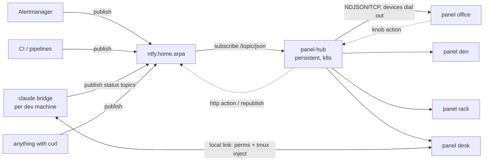

# ntfy Integration — Handoff Guide

Evolving claudepanel from a single-purpose Claude Code monitor into a
4-device notification fleet with `ntfy.home.arpa` as the hub.
This doc is the working spec: what exists, what's designed, what's left,
and where each piece of work happens.



## What exists today

| component | state | location |
|-|-|-|
| firmware 0.2.0 | working: claude status/menu/perm screens, TCP client link, WiFi telemetry + strongest-BSSID roaming, **notify stack + card/gauge/list/graph views**, `DEVICE_NAME` identity | `firmware/` |
| bridge (claude-local) | working: statusline/hook/permission intake, tmux injection, `POST /notify` local intake, action execution, optional ntfy session publishing | `bridge/bridge.py` |
| panel-hub | implemented: multi-device server, ntfy streaming subscriber, topic router, action executor; **not yet deployed** | `hub/` |
| ntfy (live) | `https://ntfy.home.arpa` — LXC vmid 422 via Caddy, compose-deploy role, **auth required** (`NTFY_AUTH_USERS`/`NTFY_AUTH_TOKENS` provisioned from 1Password Connect at runtime; apps use the shared `apps_token`) | `infra/ansible/roles/compose-deploy/files/ntfy/` |
| ntfy (k8s manifest) | `ntfy.anvilcortex.com` — manifest exists but the host 404s at the ingress (no matching rule) and it has no auth; stale relative to the live LXC deployment, reconcile in infra | `infra/k8s/apps/ntfy/` |

The claude-local bridge never goes away: permission round-trips and tmux
injection are inherently local to the machine running the sessions. The
hub is a second, deployable consumer of the same device-link protocol.

## Device fleet

Four CrowPanel 1.28" HMI ESP32-S3 units. Each gets:

- a name baked at build time (`DEVICE_NAME` in `firmware/.env`, sent in
  the `hello` message)
- a DHCP reservation and a DNS record on `home.arpa`
  (e.g. `panel-office.home.arpa`) — note the devices are TCP *clients*;
  the DNS names exist for OTA (`pio run -t upload --upload-port
  panel-office.home.arpa`) and future admin HTTP, not for the hub link
- a `BRIDGE_HOST` to dial. `WiFiClient::connect()` resolves hostnames,
  so this can be `panel-hub.home.arpa` — no firmware change needed

Interim topology until the hub exists: the desk device keeps dialing the
Mac's local bridge (today's setup); the other three dial the hub. Target
topology: all four dial the hub, and the claude-local bridge connects to
the hub as a *producer*, relaying session status and permission requests
for whichever device the config maps them to. The relay uses the same
message shapes end-to-end, so firmware doesn't change between the two.

## Notification schema

Two tiers, both carried over ntfy's native message model so any
ntfy-capable producer works without knowing about the panels.

### Tier 1 — card (plain ntfy messages)

Any ntfy publish renders as a card. Field mapping:

| ntfy field | device rendering |
|-|-|
| `title` (`X-Title`) | card headline |
| `message` (body) | word-wrapped body |
| `priority` (`X-Priority` 1-5) | interaction semantics, below |
| `tags` (`X-Tags`) | first emoji-mappable tag becomes the card icon; a `panel-color:RRGGBB` tag overrides accent color |
| `actions` (`X-Actions`) | knob-selectable action list; `http` actions fire from the hub, `view` actions are ignored (no browser) |

```sh
curl -H "X-Title: backup failed" -H "X-Priority: 4" -H "X-Tags: rotating_light" \
  -H "X-Actions: http, Retry, https://runner.home.arpa/api/retry/backup, method=POST" \
  -d "nightly restic run exited 1 on tank" \
  https://ntfy.home.arpa/infra-alerts
```

### Tier 2 — template views (JSON message bodies)

If the message body parses as JSON with a `view` key, the hub forwards
it as a template payload instead of a card. Templates are designed once
in firmware for the round 240x240 display:

| view | payload fields | rendering |
|-|-|-|
| `gauge` | `value`, `max`?, `unit`?, `label`?, `color`? | big number + arc ring (same visual language as the context ring) |
| `list` | `title`?, `items: [{label, value, color?}]` (max ~6) | label/value rows |
| `graph` | `title`?, `points: [n...]` (max ~60), `unit`?, `color`? | sparkline + last value |
| `card` | `title`, `body`, `icon`?, `color`?, `actions`? | explicit tier-1 card |

```sh
curl -d '{"view":"gauge","label":"tank pool","value":81,"unit":"%","color":"#D97757"}' \
  https://ntfy.home.arpa/infra-status
```

A template message *replaces* the previous template from the same topic
on the same device (it's a dashboard slot, not a stack entry). Cards
stack. This means a topic like `infra-status` can stream gauge updates
while `infra-alerts` accumulates cards.

### Priority semantics

| priority | device behavior |
|-|-|
| 5 | interrupt: pop over any screen, red accent, optional beep |
| 4 | pop over status screen (like permission prompts today) |
| 3 (default) | join notification stack, subtle indicator on status screen |
| 1-2 | silent: only visible when rotating through the stack |

Knob model: rotate scrolls the stack / selects actions, click fires the
selected action (or dismisses if none), long-press dismisses. Cards
expire via ntfy's `X-Expires`/hub-side TTL (default 30 min).

## Routing config (hub)

```json
{
  "ntfy_url": "https://ntfy.home.arpa",
  "devices": {
    "office": {"topics": ["infra-alerts", "infra-status"]},
    "den":    {"topics": ["infra-alerts"]},
    "rack":   {"topics": ["infra-status", "pipeline"]},
    "desk":   {"topics": ["pipeline", "claude"]}
  },
  "device_port": 8788
}
```

The hub subscribes once per unique topic
(`GET {ntfy_url}/{t1},{t2}/json` streaming, reconnect with `since=<id>`)
and fans out to every connected device mapped to that topic. Devices are
keyed by the `name` in their `hello`; unknown names get logged and
nothing else.

## Device link protocol (NDJSON over TCP, device dials out)

Existing (implemented in firmware 0.1.4 and `bridge/bridge.py`):

| dir | `t` | fields |
|-|-|-|
| dev → hub | `hello` | `fw`, `name`, `rst`, `up` |
| dev → hub | `perm_result` | `id`, `result` (allow/deny/pass) |
| dev → hub | `inject` | `sid`, `text` |
| dev → hub | `dbg` | `m` (heartbeat carries rssi/drops/rsn) |
| hub → dev | `status` | session upsert: `sid`, `title`, `model`, `tool`, `state`, `ctx`, `cost` |
| hub → dev | `remove` | `sid` |
| hub → dev | `perm` | `id`, `sid`, `tool`, `detail`, `timeout` |
| hub → dev | `perm_cancel` | `id` |
| hub → dev | `presets` | `items: [{label, text}]` |
| hub → dev | `cfg` | `enc_div`, `beep`, `leds` |
| hub → dev | `toast` | `m` |

Notification messages (implemented in firmware 0.2.0):

| dir | `t` | fields |
|-|-|-|
| hub → dev | `notify` | `id`, `topic`, `view` (card/gauge/list/graph), `priority`, `ttl`, plus per-view payload above |
| hub → dev | `notify_del` | `id` (hub-side expiry/ack) |
| dev → hub | `notify_action` | `id`, `action` (index), or `dismiss: true` |

Device-side semantics: 8-slot stack, template views replace by topic,
cards stack (full stack evicts expired then oldest-lowest-priority).
Priority 5 interrupts any screen except an active permission prompt;
4 pops over status; 3 and below sit in the stack behind the amber count
pill. The stack is reached via the presets menu ("notifs (N)"). Rotate
scrolls, click enters/fires actions, long-press dismisses (reported to
the hub as `dismiss`).

The local bridge exposes the same intake as the hub will:
`POST 127.0.0.1:8787/notify` with the wire schema above (plus ntfy-style
`message`/`actions[{label,url,method,headers,body}]`) — useful for
local scripts and for exercising a device without the hub.

## panel-hub deployment shape

Single-file Python asyncio service, same skeleton as `bridge/bridge.py`
(reuse the `device_server` / NDJSON send/readline code; strip the
statusline/hook/tmux parts, add the ntfy subscriber and router).

- container: `python:3.12-slim`, only stdlib + `aiohttp`
- config: env vars (`NTFY_URL`, `PANEL_CONFIG=/etc/panel-hub/config.json`,
  `DEVICE_PORT=8788`) with the routing config mounted as a ConfigMap
- k8s: mirror the `k8s/apps/ntfy/` layout (namespace, deployment with the
  same securityContext/resource conventions, service). The device link is
  raw TCP, so expose 8788 via the nginx ingress `tcp-services` ConfigMap
  or a LoadBalancer service — HTTP ingress won't carry it. The hub's own
  HTTP (health, config reload) can ride normal ingress at
  `panel-hub.home.arpa`
- DNS: `panel-hub.home.arpa` → the TCP entry point; this is the one name
  all device `.env` files bake as `BRIDGE_HOST`

Auth: the live ntfy requires tokens (anonymous publish/subscribe returns
403 — verified). The hub reads `NTFY_TOKEN` (env, e.g. from a k8s secret)
or `NTFY_TOKEN_FILE` (op-style `/run/op` mount, matching the ntfy LXC's
own provisioning pattern) and sends `Authorization: Bearer` on the
subscribe stream. The local bridge accepts `ntfy_token` in its config for
session publishing. Give the hub a read-mostly token; producers get
write-only tokens per topic. Tokens never live in this repo.

## Claude Code as a producer

Two integrations, both already half-built:

1. Local (working today): statusline/hooks → local bridge → desk device.
   Stays as-is for permission round-trips and tmux injection.
2. Hub relay (target): the local bridge additionally opens a producer
   connection to the hub (or simply publishes to a `claude` ntfy topic
   as tier-2 `list`/`gauge` payloads — session list, context %, cost).
   Cheap first step: a 20-line addition to `bridge.py` publishing on
   every statusline post, no hub knowledge required.

## Firmware iteration guide (do this on the Mac, device on USB)

Work items, in order:

1. `DEVICE_NAME` in `.env` → `env_flags.py` → `hello` (trivial)
2. `notify` handler + card screen + stack (model: fixed array of ~8
   notifications in PSRAM-backed heap; UI: new `Screen::NOTIF`)
3. priority interrupt rules (reuse the perm-screen pop-over pattern)
4. `notify_action` on knob input (reuse perm confirm flow)
5. template renderers: gauge (fillArc exists), list, graph
6. bump `rxBuf` to 2048; drop the per-retry scan dump once stable

Build/flash/debug:

```sh
cd firmware
pio run -t upload --upload-port /dev/cu.usbmodem1101   # USB
pio run -t upload --upload-port claudepanel.local      # OTA, password claudepanel
# serial capture (opening the port may reset the chip):
/opt/homebrew/Cellar/platformio/*/libexec/bin/python -c "
import serial,time; p=serial.Serial('/dev/cu.usbmodem1101',115200,timeout=1)
t=time.time()
while time.time()-t<60:
    d=p.read(4096)
    if d: print(d.decode(errors='replace'),end='')"
```

Fake-device smoke test against a hub/bridge without hardware:

```sh
python3 -c "
import socket,json
s=socket.create_connection(('127.0.0.1',8788))
s.sendall((json.dumps({'t':'hello','name':'fake','fw':'0'})+'\n').encode())
print(s.recv(4096).decode())"
```

## Roadmap

Work in this repo is done in-session on the Mac (firmware, hub, bridge);
only the infra-repo items are yours to carry into IaC.

- [x] firmware: notify stack + card/gauge/list/graph views, DEVICE_NAME (0.2.0)
- [x] bridge: `POST /notify` intake, action execution, optional ntfy session publishing
- [x] hub: multi-device server, ntfy streaming subscriber, topic router, action executor (`hub/`)
- [ ] infra: `k8s/apps/panel-hub/` manifests from `hub/Dockerfile`, TCP exposure for 8788, `panel-hub.home.arpa` DNS (infra repo)
- [ ] infra: DHCP reservations + `panel-*.home.arpa` records for the four devices (infra repo)
- [ ] infra: ntfy auth tokens once anything is internet-reachable (infra repo)
- [ ] flash + register remaining three devices (`DEVICE_NAME` per device, dial `panel-hub.home.arpa`) — here, once the hub is live
